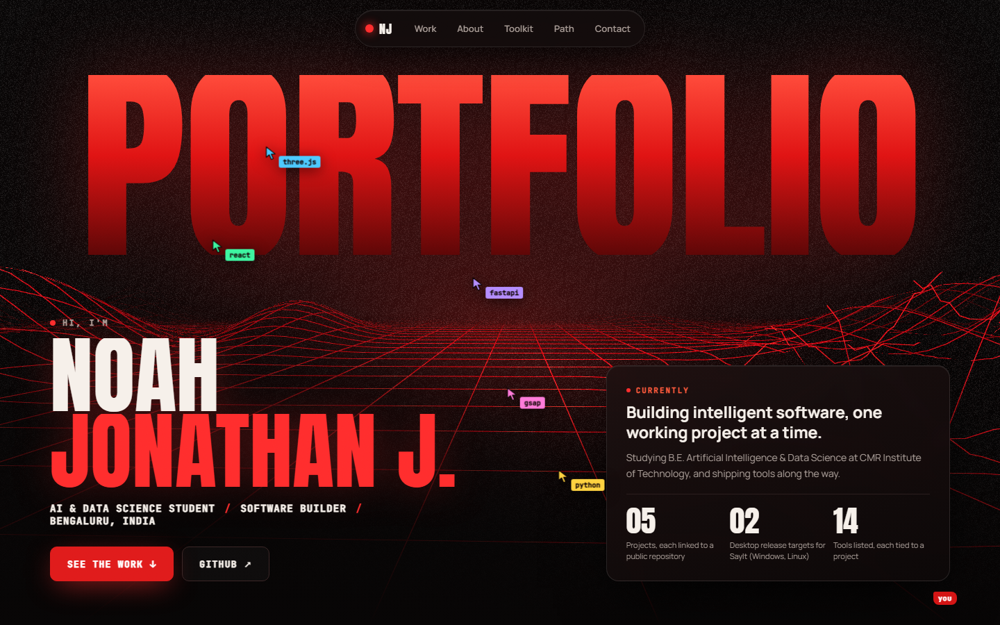
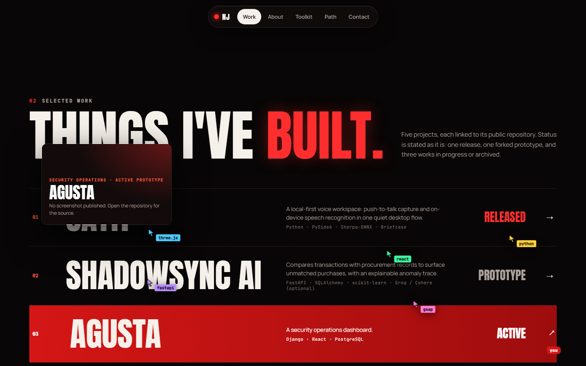

# Portfolio — Noah Jonathan J.

An immersive, black-and-red portfolio for **Noah Jonathan J.**, an AI & Data Science student in Bengaluru who builds intelligent software. Built with Next.js, React Three Fiber and GSAP.

**Live site:** not deployed yet. See [Deployment](#deployment).



## What's on the page

- **Hero**: a giant gradient "PORTFOLIO" word over a red WebGL grid floor that bends toward the pointer and speeds up as you scroll.
- **Agent cursors**: decorative, Figma-style cursors labelled with the tools used (python, react, fastapi, three.js, gsap). They wander the page and "select" section headings as they scroll into view. They are tool names, never people's names.
- **Intro**: the cursors sketch a wireframe of the page while real assets load (fonts, screenshots, the 3D bundle). Skippable, plays once, home page only.
- **Things I've built**: five project rows with a hover preview. SayIt and ShadowSync AI open case studies; the rest link to GitHub.
- **Every claim. Linked.**: a verified-only timeline (degree, SayIt's public releases, this site).
- **The toolkit**: four tilt cards. Select a tool to see the project that uses it.
- **Contact**: LinkedIn and GitHub, plus a canvas swarm of tiny cursors that bursts on click. There is no contact form on purpose: there is no backend behind one.



## Honesty rules

The content lives in one typed file, [`lib/content.ts`](lib/content.ts), and every entry is tied to a public repository.

- No photograph is shown (none was supplied). To add one, put an image in `public/` and set `portrait` in `lib/content.ts`.
- No invented clients, metrics, employment, awards, certificates, email address or résumé.
- Skills carry no percentages or seniority labels.
- Project status is stated as it is: SayIt has public Windows and Linux releases; ShadowSync AI is a forked prototype.
- Nothing here claims a deployment, users or measured impact.

## Stack

| Area | Tools |
|---|---|
| Framework | Next.js 15 (App Router), React 19, TypeScript (strict) |
| 3D | three.js, React Three Fiber, a custom shader grid, bloom/grain post-processing |
| Motion | GSAP + ScrollTrigger, Lenis smooth scrolling (native scrollbar and anchors still work) |
| State | zustand |
| Fonts | Anton, Manrope, JetBrains Mono (self-hosted via `@fontsource`, SIL OFL) |

Graphics quality has three tiers (Ultra, Balanced, Eco). The tier is picked from the device and then adjusted from measured frame times with hysteresis. Reduced-motion and no-WebGL visitors get a complete page without the 3D floor, the cursors or the intro.

## Run locally

Requires Node.js 20 or newer.

```bash
npm install
npm run dev
```

Open <http://localhost:3000>. For a production build:

```bash
npm run build
npm start
```

## Checks

```bash
npm run typecheck
npm run qa:xp
```

`qa:xp` drives Chromium (Playwright) against a running production server and writes `qa/xp/report.json` plus screenshots. Start `npm start -- --port 3003` first, or set `PORTFOLIO_URL` to point it elsewhere.

Last run, on this code, against a production build:

- No horizontal overflow at 320, 375, 390, 768, 1024, 1440, 1920, 2560 and 3840 px wide.
- axe-core (WCAG 2.0/2.1/2.2 A and AA tags): 0 violations. This is an automated scan and not a conformance claim.
- 0 console errors or page errors.
- Intro, reduced-motion and no-WebGL paths, the toolkit, the row preview and the mobile menu all work by interaction.
- First-load JavaScript for `/` is 166 kB as reported by `next build`.

Not tested: real phones, Safari and Firefox, screen readers. Headless-Chromium frame rates use software rendering and say nothing about real GPUs, so no frame-rate figure is claimed.

More detail, including what was deliberately not built, is in [PORTFOLIO-BEYOND-REALITY.md](PORTFOLIO-BEYOND-REALITY.md). Factual sources for the copy are in [PRODUCT.md](PRODUCT.md).

## Project layout

```text
app/                 routes, global styles (beyond.css), case-study pages
components/xp/       hero grid, cursors, loader, swarm, nav, page sections
lib/                 typed content (content.ts), store, shared pointer state
public/              project screenshots, licence files
scripts/             Playwright QA scripts
```

## Deployment

The site is a standard Next.js app with only static pages, so it deploys as-is to any Next host, for example Vercel (import this repo; no environment variables are needed). Nothing is deployed from this repository yet, so there is no live link to list. Once it is published, put the URL in the repository's About box and replace the "Live site" line above.

## Licence

[MIT](LICENSE) for the code. The SayIt screenshots in `public/projects/sayit/` come from the public SayIt repository. three.js, React Three Fiber, Lenis, zustand and Next.js are MIT. GSAP is used under GSAP's standard licence (see `public/assets/GSAP-LICENSE.txt`).
